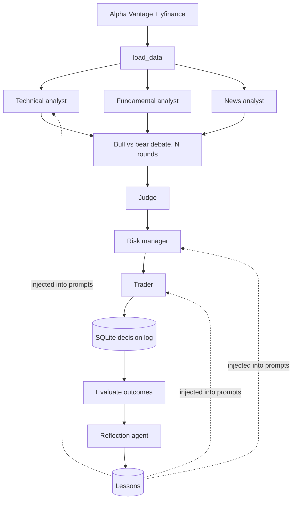

# LLM-Powered Multi-Agent Trading System

A multi-agent LLM pipeline built with **LangGraph**. Specialist analyst agents examine a stock, a bull and a bear
agent debate the evidence, a risk manager and trader turn the verdict into a sized, risk-limited decision, and
every run is logged to SQLite so later runs can learn from outcomes.

> **Paper trading and decision support only. This is not financial advice, and it never places real orders.**

## Architecture



1. **Data**: daily prices, quarterly earnings and income statements (Alpha Vantage); valuation ratios and headlines
   (yfinance); broad-market conditions from SPY.
2. **Analysts** (run in parallel): technical, fundamental and news agents each return a structured report.
3. **Debate**: bull and bear agents argue over the reports for a configurable number of rounds; a judge decides
   which way the evidence leans.
4. **Risk and decision**: stop-loss and maximum position size are computed in code; an LLM risk manager chooses how
   much of the limit to use; a trader chooses BUY, SELL or HOLD; code guards enforce consistency.
5. **Memory**: each run is saved to SQLite. Past decisions are scored against what the price did next, a reflection
   agent writes short lessons, and those lessons are added to later prompts.

## Design principles

- **Code for guarantees, LLMs for judgment.** Indicators, valuation ratios, stops and position sizes are computed in
  Python. LLMs interpret facts; they never do arithmetic.
- **Prompts request, code enforces.** LLMs ignore prompt rules often enough that critical rules (confidence caps,
  "no SELL without a position", size limits) are plain `if` statements. Every override is recorded in the log.
- **Structured outputs everywhere.** Agents return validated Pydantic objects, not free text.
- **Untrusted text is data.** Headlines are fenced and the model is told never to follow instructions inside them.
- **Skeptical learning.** Lessons come only from clear wins and losses, can be rejected as noise, are deduplicated per
  stock per day, and are injected as hypotheses that must not override current data.

## Tech stack

Python, LangGraph, LangChain (OpenAI, `gpt-4o-mini` by default), Pydantic, Alpha Vantage API, yfinance, pandas,
SQLite, Docker, pytest.

## Quick start

Requires Python 3.11+, an OpenAI API key, and a free [Alpha Vantage key](https://www.alphavantage.co/support/#api-key).

```bash
git clone https://github.com/<your-username>/llm_trading_agents.git
cd llm_trading_agents
python -m venv .venv
source .venv/bin/activate        # Windows: .venv\Scripts\activate
pip install -r requirements.txt
cp .env.example .env             # Windows: Copy-Item .env.example .env
# edit .env and add your keys
```

```bash
python -m trading_agents run AAPL            # analyse a ticker
python -m trading_agents run AAPL MSFT --verbose
python -m trading_agents history             # recent decisions
python -m trading_agents evaluate            # score decisions old enough to judge (5 trading days)
python -m trading_agents reflect             # turn outcomes into lessons
python -m pytest -q                          # tests
```

### Docker

```bash
docker compose build
docker compose run --rm agents run AAPL
docker compose run --rm agents history
```

Keys are read from `.env` at runtime and are never copied into the image. The SQLite database lives in a named
volume, so the log survives between runs.

## Project layout

```
trading_agents/
  config.py        settings from environment / .env
  llm.py           model factory
  alphavantage.py  API client with throttling and SQLite caching
  yahoo.py         valuation and headline client (yfinance)
  indicators.py    RSI, MACD, moving averages, market-stress measures
  fundamentals.py  normalises mixed-unit data into labelled facts
  schemas.py       Pydantic models for every agent output
  analysts.py      technical, fundamental and news agents
  debate.py        bull, bear and judge nodes
  risk.py          position sizing, stops, risk flags (pure code)
  trading.py       risk manager and trader, with code guards
  graph.py         the LangGraph pipeline
  decision_log.py  persistent decision log
  evaluate.py      forward-walk scoring of past decisions
  reflect.py       lessons table, reflection agent, prompt injection
  replay.py        point-in-time sandbox replay of the technical analyst
  __main__.py      command-line interface
tests/
```

## Limitations

- **Free data is thin.** Alpha Vantage's free tier allows 25 requests per day, and its overview and news-sentiment
  endpoints are premium, so fundamentals and headlines come from yfinance, an unofficial source that can break.
- **One week is noise.** Outcomes are scored over 5 trading days against raw returns (not market-adjusted). Early
  lessons come from very few trades and are hypotheses, not findings. No claim is made that this system has an edge.
- **No portfolio ledger.** The position is always assumed flat, so SELL never fires; the system decides whether to
  open a long position.
- **Debate quality is bounded by evidence.** Both sides see the same reports, so extra rounds add little.
- **Rules are crude.** For example, the stop (3× daily volatility) is tight relative to a 5-day horizon, and the
  take-profit